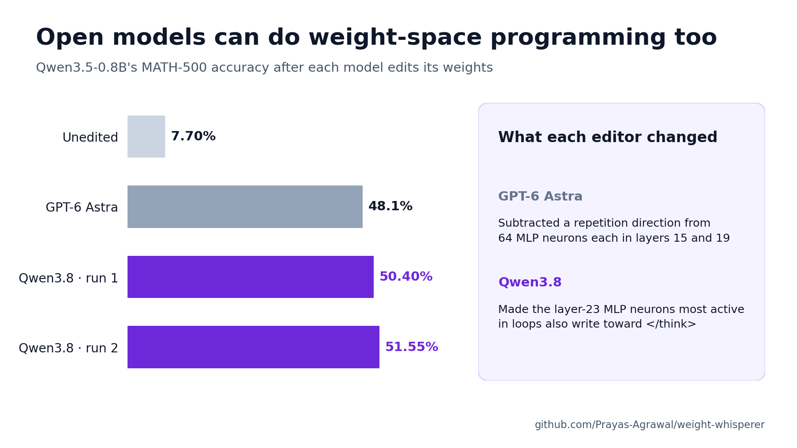

# Weight Whisperer

**Open models can do weight-space programming too.**



[Sparks of Weight-Space Programming](https://rikiyat.github.io/blog/weight-space-programming/)
showed GPT-6 Astra editing Qwen3.5-0.8B's weights directly, with no training, and
raising its MATH-500 accuracy from 7.9% to 48.1%. We gave the same task to
**Qwen3.8**, an open-weight model.

| Editor | MATH-500 |
|---|---|
| GPT-6 Astra | 7.9% → 48.1% |
| Qwen3.8, run 1 | 7.70% → **50.40%** |
| Qwen3.8, run 2 | 7.70% → **51.55%** |

Scores average four samples on all 500 questions, with thinking on and up to
32,768 tokens per answer.

## What each editor was given

Both editors started from the original weights, ran their own experiments and never
saw MATH-500. Both had:

- a sandboxed Python environment over the weights, with helpers to load and save edits;
- practice math problems with answers, none from the benchmark;
- a tool to run the model: graded answers, side-by-side comparisons of the original
  and edited weights, and activation reads on any text;
- the model's architecture and evaluation settings, described upfront;
- a prompt naming repetitive, never-finishing reasoning as a failure worth fixing;
- the same rules: no training or gradients, and the embeddings, output layer and
  final norm stay fixed.

The setups differed in budget and guidance:

| | GPT-6 Astra | Qwen3.8 |
|---|---|---|
| Budget | A fixed number of model runs, all used | None; it chose when to submit |
| Asked for | Edits grounded in understanding the network, backed by causal evidence | Useful accuracy; known interpretability methods welcome |
| Method hints | Show a component drives the failure, test several strengths, measure with enough samples | Contrast productive and failing reasoning, check an edit's effect on next-token probabilities first, separate solving from ending the reasoning |

Qwen3.8's hints point at the moment reasoning ends and the answer begins, which is
where its edits act. Full prompts: [Qwen3.8](configs/user_prompt.txt),
[GPT-6 Astra](https://github.com/RikiyaT/lm_understand-logs/blob/4d09ba6d6a7e891dd8063974dfe81b3d78e3494f/exp8_math/runs/p50c/turns/t001/prompt.txt).

## The failure

Qwen3.5-0.8B often works out an answer, then keeps re-checking it ("Wait, …")
until it runs out of tokens: 93% of its MATH-500 answers hit the 32,768-token limit.
Both editors found this by reading the model's own practice answers.

## What GPT-6 Astra did

1. Compared the model's activations on matched productive and looping reasoning,
   giving a "repetition" direction `u`.
2. Found the 64 neurons in each of the MLPs of layers 15 and 19 that write `u` most.
3. Subtracted `u` from those neurons' output weights:

```text
W ← W − 6 · u (uᵀW)        64 neurons each, layers 15 and 19
```

## What Qwen3.8 did

1. Recorded the last layer's MLP activations on the model's own looping and
   productive reasoning.
2. Contrasted them, giving `v`: the pattern of neuron activity that marks a loop.
3. Edited that layer's MLP output weights so the neurons in this pattern also write
   the direction of `</think>`, the token that ends thinking:

```text
W ← W + α · e(</think>) vᵀ   layer 23
```

The edited model is an ordinary checkpoint: only this matrix differs, and the
embeddings and output layer are untouched. In a loop, the neurons in `v` are active,
so their output now pushes the next token toward `</think>`, and the model ends its
thinking and writes its answer. `bash scripts/run.sh inspect-edit` shows that over
99% of each published edit is this one component.

## Underlying mechanism

The two edits change different layers in different ways, but both were built with
the same steps:

1. contrast activations between looping and productive reasoning,
2. turn the difference into a direction,
3. apply a rank-one edit to an MLP's output weights.

It seems that the underlying mechanism is a familiar one from mechanistic
interpretability: difference-of-means directions, as used to
[remove refusal](https://arxiv.org/abs/2406.11717), combined with rank-one MLP edits,
as in [ROME](https://arxiv.org/abs/2202.05262). In this experiment, both editors
appear to apply these established techniques end to end, and an open-weight model
can carry them out as well.

## Check the results

Linux and Python 3.12.

```bash
bash scripts/run.sh setup
bash scripts/run.sh verify-result                 # recompute every score from per-sample records
bash scripts/run.sh prepare                       # download the original model and data
bash scripts/run.sh inspect-edit                  # rebuild both edits and show their structure
bash scripts/run.sh evaluate my-eval --edit run2  # re-run full MATH-500 on a published edit (GPUs)
```

## Run it yourself

A new autonomous run needs four high-memory GPUs.

```bash
bash scripts/run.sh setup
bash scripts/run.sh reproduce my-run  # new editing run from the original weights, then full MATH-500
```

Edits: [run 1](artifacts/run1/), [run 2](artifacts/run2/). Scores: [results/](results/).

Thanks to the authors of [Sparks of Weight-Space Programming](https://rikiyat.github.io/blog/weight-space-programming/)
for releasing their prompts, logs and edits, which made this comparison possible.

Code and edits: [Apache-2.0](LICENSE). The editor model uses the Qwen Community
License. See [NOTICE](NOTICE) for attribution and model and data licenses.
